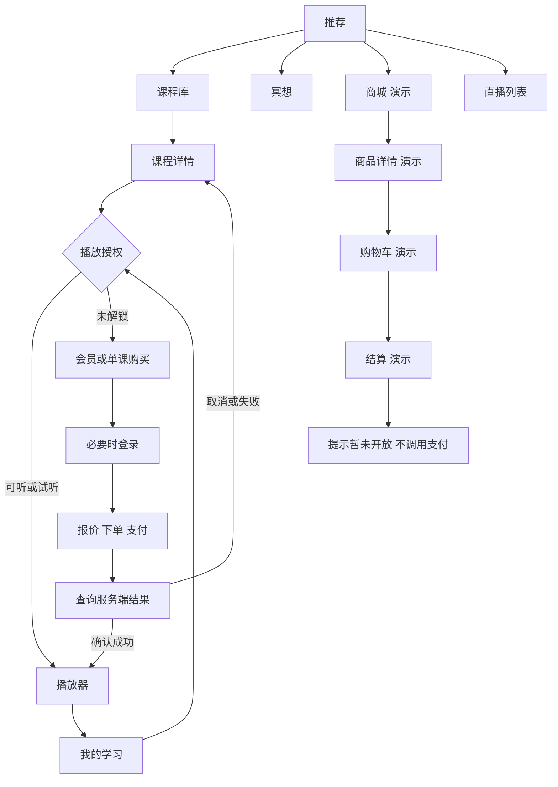
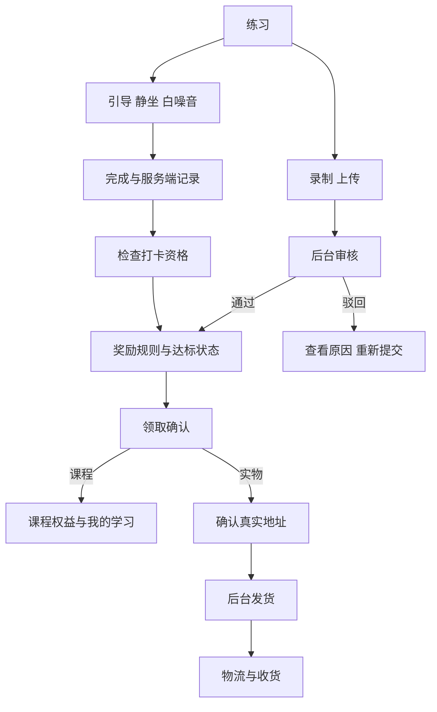

# 澄心涧页面与交互规格表

版本：0.1 草案  
日期：2026年11月9日  
用途：前端页面、交互、动效、模拟数据及后续接口对接的实施依据。

进度更新（2026-11-10）：本表保留目标业务范围；用户后续已授权开发。PDF S1–S22页面及基础动效完成，具体已实现/占位/待联调状态以[前端统一验收清单](前端统一验收清单.md)为准。当前默认配色遵循新PDF的松石夜色，商城和直播由“我的”进入；不把原规格的未来要求视为已经实现。

## 一 已确定的产品选择

| 项目 | 本次决定 |
| --- | --- |
| 视觉依据 | 直接还原甲方前端效果图，不另做全新视觉稿；墨绿V2为默认依据，V1补充页面；咱们设计点击和状态动效 |
| 默认主题 | 墨绿 forest；同时提供松石夜色 turquoise、浅色宣纸 paper |
| 固定底栏 | 推荐、冥想、课程、练习、我的；三主题及各主页面保持一致 |
| 商城和直播 | 保留完整页面，从推荐页快捷入口进入；我的保留商城入口与订单入口 |
| 真实业务范围 | 思维导图内全部功能，计划对接同事的后端 |
| 原型额外功能 | 纳入前端页面和交互，以演示占位方式实现，不自动增加后端任务 |
| 当前任务边界 | PDF页面精修与前端演示，等待统一验收；真实业务及额外补全页后续联调 |

V2 首页与商城页原本存在“课程/商城”底栏不一致，本次已由用户选择统一为首页图版本。其他页面继续还原原型内容；首页新增/保留清晰的商城和直播入口，避免页面只能通过开发者手动输入地址访问。

## 二 功能标记和交互通则

- **R 计划接真实接口**：后端服务属于本期范围。接口尚不可用时可以 Mock，但不代表真实功能已实现。
- **D 演示占位**：只做界面和约定的演示交互，没有对应生产后端承诺。
- **L 本地前端能力**：如主题、搜索历史、弹层、动画，不需要业务服务；涉及平台权限仍单独验证。
- **R+D 混合页面**：真实与演示区域须明确分开，禁止用演示积分、折扣或课程券参与真实报价。

下表的编号用于任务、设计和验收追踪，不等于每行都需要新增独立路由。标为“共用页”“弹层”“状态”的项目应复用结构。

通用状态：G=加载、正常、空数据、失败重试；A=未登录、已登录、账号受限；E=免费/试听、会员、已购、未解锁、权益过期；U=上传中、成功、失败重试。每行在 G 基础上增加列出的状态；没有列表内容的页面按实际适用项执行。

通用返回规则：列表进入详情后返回，保留筛选、滚动与关键词；登录后回到原操作；刷新或重新进入时重新核验权益。直接分享进入详情没有历史栈时返回对应主页面。未保存表单离开时提醒，普通浏览返回不弹无意义确认。

演示规则：D 页面顶部显示“演示功能”，固定示例数据统一标注；购物车增减、选规格、切换优惠项可在本地演示。点击付款、提现、开自动续费或发放实物，显示“演示功能，暂未开放”，不创建真实交易、不采集真实提现实名信息、不显示真实到账成功。需要展示成功状态时，通过单独的“状态预览”切换，保留演示标识。

所有编号页面使用三主题。导航、弹窗、加载/失败态、图表和播放器同时换色；切换不重置已输入内容或播放状态。正式版本默认关闭 D 模块；如将来保留公开入口，统一显示未开放，不能仅在审核期间隐藏后再秘密启用。

## 三 小程序页面规格总表

P 为 V1 屏号；S 为两个 V2 的共用屏号。新增补全页是为思维导图流程闭环补齐，不声称原型已经画出。接口组对应第七节。

| 编号 | 页面或视图及来源 | 类型 | 入口与内容 | 主要动作和去向 | 特殊状态及验收重点 |
| --- | --- | --- | --- | --- | --- |
| M01 | 品牌开屏 P01 | L | 首次进入；品牌、水波、进入按钮 | 进入推荐或可跳过的偏好页 | 不强制等待3秒，不阻止再次访问；品牌动画可停止 |
| M02 | 登录 P02 | R | 需要身份时；微信、手机号验证码、密码模式 | 登录成功恢复原页面；转注册/找回 | A；协议默认未勾选；取消授权可继续浏览 |
| M03 | 注册与找回密码 补全 | R | 登录入口；手机号、验证码、密码 | 完成注册或重设密码；返回登录 | 验证码倒计时、错误、过期、发送失败；模式共用表单 |
| M04 | 偏好引导 P03 | D/L | 首次引导或设置；6项最多选3项 | 下一步或跳过进入推荐 | 本地保存；匹配课程数为示例，不宣称真实算法推荐 |
| M05 | 推荐 P04/S1 | R+D | 主底栏；问候、大卡、继续播放、新课、打卡条 | 大卡进入鉴权播放；更多到课程/冥想；商城D、直播R快捷入口 | A/E；游客不虚构学习记录；商业模块有演示标记 |
| M06 | 冥想 S2 | R | 主底栏；助眠专区、心境分类、热门音频 | 八宫格进入独立分类列表 → M15详情 → M12播放；全部/更多进入全部分类列表，热门音频直接进入M15 | E；每类暂一条演示占位；类别不足不编造线上分类 |
| M07 | 课程库 P06/S3 | R | 主底栏、推荐、搜索；筛选、大卡、列表 | 分类/难度/时长筛选；进入M10 | E；保留滚动和筛选，分页失败可重试 |
| M08 | 搜索 P05/S13 | R+D/L | 顶部搜索；热词、历史、分组结果 | 搜课程/冥想/讲师/直播；商品结果进入D02 | 商品使用独立演示结果；历史本地可删；R搜索失败不静默改为假结果 |
| M09 | 通知列表及详情 补全 | R | 推荐/我的；公告、时间、正文 | 查看详情、标记已读 | 无公告、下架、长文本、失败重试；列表与详情两个视图 |
| M10 | 课程详情 P07/S4 | R | 列表、搜索、分享；封面、讲师、目录、价格 | 试听/播放→M12；收藏；购买→M31；会员→M30 | A/E；未授权课节不直接播放；返回恢复列表 |
| M11 | 讲师详情 补全 | R | 课程/搜索/直播；介绍、资质、关联内容 | 关注；查看课程或直播 | 关注失败回滚；资料缺项不展示虚构资质 |
| M12 | 沉浸播放器 P08/S5 | R+L | 课节、推荐、学习；音频/视频、进度、标题 | 播放/暂停、跳转、倍速、定时、收藏、留言M13 | E；缓冲、中断、地址过期、结束；本地假播放与真播放不得混淆 |
| M13 | 共修留言 P24 | R | 播放器/课程；热门、最新、老师回复 | 发言、回复、点赞、举报 | A；待审核仅本人可见；发送失败保留草稿，不重复插入 |
| M14 | 练习与打卡 P14/S10 | R+D | 主底栏；日历、连续天数、里程碑、练习入口 | 静坐M16、白噪音M17、引导M15；领奖M22；录制M24 | 未达标/可打卡/已打卡；积分区D，不改变R资格 |
| M15 | 引导冥想详情 补全 | R | 冥想分类列表/热门音频；封面、介绍、时长 | 开始练习，复用M12播放；真实业务接入时关联练习会话 | E；当前只做界面和跳转，暂停/完成不得虚增练习数据 |
| M16 | 定时静坐 P19 | R+L | 练习/首页计时器；预设和自定义时间、提示音 | 设置→开始→暂停/继续→结束M18 | 未开始/进行/暂停/提前结束；后台恢复按时间计算 |
| M17 | 白噪音混音 P09/S6 | R+D | 练习；最多5轨、独立音量、定时、预设 | 添加/关闭音轨、拖动音量、暂停、结束 | 缓冲/错误；后台预混能力按实际验证；个人配方保存/分享D |
| M18 | 练习完成 补全 | R | 会话结束；本次时长、结果 | 查看统计、打卡、返回练习 | 提交中/服务端确认/失败；未确认不宣称计入奖励 |
| M19 | 我的学习 P20 | R | 我的/继续学习；未学完、完成、已购 | 继续对应课节→M12 | E；进度为空、内容下架；进度不用演示时长覆盖 |
| M20 | 收藏 P22 | R+D | 我的；课程、音频、回放、商品 | 打开内容、取消收藏；商品进入D02 | 商品D单独分区；取消失败恢复原项 |
| M21 | 学习记录及静心报告 P21/S14 | R+D | 我的/练习；历史、周/月统计、图表 | 切日期、打开记录；报告分享预览 | 无数据、部分数据；洞察/隐藏徽章未有算法时标D，不伪造真实结论 |
| M22 | 奖励列表及详情 补全 | R | 打卡里程碑/我的奖励；规则、进度、实物/课程 | 查看规则；达标后领奖M23 | 未达标/达标/已领/缺货/失效；真实资格来自后端 |
| M23 | 领奖确认及我的奖励 补全 | R | 奖励详情；奖品、资格、地址、记录 | 确认地址领取；课程→学习；实物→订单/物流 | 领取中/成功/失败/重复领取；缺地址先补齐，避免默认旧地址静默发货 |
| M24 | 录制与上传 补全 | R | 练习/打卡；录制、选择文件、预览、说明 | 开始/结束录制、重录、上传并提交 | U；授权拒绝、超限；格式由正式规则配置，默认不公开 |
| M25 | 提交记录及审核详情 补全 | R | 上传结果/我的；记录、附件、审核意见 | 查看、驳回后重新提交、通过后领奖 | 待审/通过/驳回；上传成功不等于奖励成功 |
| M26 | 直播列表 P16/S11 | R | 推荐快捷入口；直播中、预告、回放 | 预约/取消、进入M27、回放M28 | E；订阅拒绝不取消预约；无直播不编造直播状态 |
| M27 | 直播间 P17/S17 | R+D | 列表/通知；画面、人数、消息、提问 | 点赞、发言、提问、老师回复、退出；礼物/连麦D | E；未开始/断流/结束/禁言/重连；不得展示虚构真实在线人数 |
| M28 | 回放详情与播放 P23 | R | 直播回放列表；录像、章节、关联回放 | 播放/跳章节、收藏、讲师详情 | E；生成中/关闭/失败/已下架；章节未配置则隐藏导航 |
| M29 | 我的 P18/S12 | R+D | 主底栏；身份、学习、会员、订单、设置 | 进入对应模块；积分/卡券/推广/商城D入口 | A；演示资产与真实资产分开，不把示例佣金算入用户资产 |
| M30 | 会员中心 P15/S9 | R+D | 我的、锁定内容；月/季/年/终身套餐、权益 | 选套餐→M31；连续包年等D弹层 | A；有效/到期/终身；商城折扣、积分倍率、离线、生日礼等未支持权益标D |
| M31 | 购买确认及支付结果 补全 | R | 会员/课程；报价、协议、订单状态 | 创建订单、调起支付、查询结果、进入权益 | 取消/处理中/成功/失败/超时；未确认不展示真实开通成功 |
| M32 | 订单列表及详情 P13/S15 | R+D | 我的；购买与奖励分类、订单明细 | 付款、取消、退款、物流、收货等按后端允许动作 | 示例商品/卡券订单放独立演示分区；R/D不能共用可支付单号 |
| M33 | 退款申请及进度 补全 | R | 订单详情；原因、规则、处理状态 | 申请、查看驳回原因或渠道说明 | 处理中/成功/失败；Apple渠道展示服务器指引，不仿造退款完成 |
| M34 | 地址列表与编辑 P29 | R | 我的、真实领奖；收件信息、地区 | 新增、编辑、删除、设置默认、选择后返回 | 校验/保存失败保留表单；演示结算只用虚构地址 |
| M35 | 物流详情 P13/S15 | R+D | 订单/奖励；运单、轨迹、签收状态 | 复制单号、刷新、返回订单 | 未发货/运输/异常/签收；D轨迹有示例标签 |
| M36 | 个人资料及账号安全 P28 | R+D | 我的；头像、昵称、账号、绑定入口 | 修改资料、进入密码/换绑/注销；Apple绑定等D | A；安全分如未有规则仅D；不得虚构已绑定账号 |
| M37 | 密码与换绑流程 补全 | R | 账号安全；验证身份、密码或新手机 | 分步验证、提交、更新状态 | 验证失败/过期/手机号冲突；失败不丢无敏感草稿 |
| M38 | 注销流程 补全 | R | 账号安全；条件、后果、进度 | 验证、申请、查看阻断项、可撤销时撤销 | 冷静期以政策为准；按钮不能模拟删除真实账号 |
| M39 | 设置 P30/S18 | R+D/L | 我的；主题、播放、提醒、缓存、退出 | 即时换主题、保存偏好、退出；APP评分/更新D | 设置项与实际能力一致；日常提醒开关不保证系统定时推送 |
| M40 | 协议与客服 共用视图 | R+L | 登录/购买/安全/我的；协议、联系方式 | 查看协议、打开真实客服或说明 | 隐私授权用平台能力；演示联系客服不能向真实人员发送示例消息 |

## 四 演示占位页面与补充功能

以下D功能已纳入前端范围。需要业务规则的价格、佣金、库存、优惠与时限只作为可更换的演示数据。

| 编号 | 页面及来源 | 入口与内容 | 允许的交互 | 截止点与验收 |
| --- | --- | --- | --- | --- |
| D01 | 商城 P10/S7 | 推荐/我的；分类、积分入口、会员折扣、秒杀 | 分类、搜索演示商品、打开详情、秒杀列表 | 所有商品为演示；返回不会改变主底栏结构 |
| D02 | 商品详情 P11/S8 | 商城/商品搜索/商品收藏；轮播、价格、规格、评价 | 选规格、看评价D05、收藏、加购D03、立即购买D04 | 未选规格先弹规格层；库存/会员折扣均标示例 |
| D03 | 购物车 P25 | 商城/商品；数量、选择、失效项、合计 | 增减、删除、全选、选中项去D04 | 失效项不能结算；合计来自统一fixture计算，不向R报价提交 |
| D04 | 商品结算 P12 | 购物车/立即购买；示例地址、积分券、金额 | 选演示地址、切优惠、填写本地示例备注 | 点击支付提示未开放；不调用真实支付或保存真实收件信息 |
| D05 | 商品评价 P26 | 商品详情；评分、标签、图片、商家回复 | 筛选、看图、切分页、预览评价表单 | 不向真实评价服务发请求，评分与条数保持示例内部一致 |
| D06 | 积分中心及明细 P27/S16 | 我的/商城/打卡；余额、任务、流水 | 切任务状态、查看规则、打开兑换D07 | 本地演示领取可变化，但不得领取R奖励或改变真实余额 |
| D07 | 积分兑换及卡券视图 原型入口补全 | 积分/商城；商品、课程券、体验券 | 看详情、兑换确认、演示状态、卡券分类 | 兑换结果标模拟；课程券不能授予真实课程权限 |
| D08 | 秒杀列表 原型入口补全 | 商城；倒计时、活动商品 | 倒计时、切商品、查看已结束状态 | 到期后显示结束，不能无说明自动重置时钟制造促销 |
| D09 | 推广中心 S19 | 我的；累计/可提/待结算佣金、比例、邀请码 | 查看规则、去海报D10、好友D11、明细D12、提现D13 | 不绑定真实推广关系，不产生真实佣金 |
| D10 | 推广海报 S20 | 推广中心；文案、海报、邀请图形 | 切文案、预览；保存时保留“演示海报”标识 | 邀请码使用显式DEMO；二维码用不可扫描示意图或受控演示目的地，不带真实返佣参数 |
| D11 | 推广好友 S21 | 推广中心；一级/二级列表、状态、贡献 | 切层级、筛选、展示匿名示例详情 | 只用虚构人物、金额，不展示真实好友私人消费数据 |
| D12 | 佣金明细 S22 | 推广中心；流水、待结算、提现、冲回 | 切状态、查看计算示例、进入D13 | 不把固定示例数字当成当前用户收入 |
| D13 | 提现弹层 原型入口补全 | 推广/明细；金额、规则 | 演示填写数额及校验 | 确认后提示未开放；不收身份证、银行卡，不调用转账 |
| D14 | 示例订单及售后状态 P13/S15补全 | M32演示分区/D04状态预览；商品/虚拟券订单 | 看订单、物流示例、退款/收货演示状态 | 全程保留演示标识，不能混入R订单数量和财务统计 |

嵌入式占位也要覆盖：会员自动续费、离线下载、生日礼盒、积分倍率、直播礼物/连麦、个人混音配方分享、报告长图/隐藏徽章、课程“加入计划”、降价提醒、数据副本下载、Apple账号绑定、淘宝地址导入、APP评分/版本检查。原型没有完整流程的，做有明确“未开放”结果的入口或弹层，不凭空增加大型业务系统。原型出现的支付宝按钮仅作演示样式或未开放说明，不作为小程序真实支付渠道。

## 五 管理后台规格总表

后台使用同一权限框架，讲师只展示授权内容。以下全部为R计划接口功能；不新增商城/积分/分销的生产管理后台。演示数据先用前端固定样例维护，避免给同事增加后台需求。

| 编号 | 页面或视图 | 入口与核心操作 | 权限和状态验收 |
| --- | --- | --- | --- |
| A01 | 登录及后台框架 | 登录、菜单、面包屑、退出 | 未登录回登录；受限账号提示；无权限页面与菜单一致 |
| A02 | 概览与数据统计 | 日活、增长、练习时长、课程播放、直播、留存 | 日期范围/空数据/失败；没有权限不展示财务卡片 |
| A03 | 用户列表与详情 | 手机/注册时间筛选、查看、封禁、用户角色 | 操作确认、失败回滚；不把会员状态当可任意修改的文本 |
| A04 | 用户活动记录 | 详情标签页查看学习、练习、直播记录 | 独立分页和日期，异常项可读，返回保持用户列表 |
| A05 | 会员与赠送延期 | 查询会员、赠送、延期、记录、撤销 | 明确对象、套餐、时长、原因；提交中禁重复 |
| A06 | 会员套餐编辑 | 月/季/年/终身、价格、权益、发布 | 正整数价格、终身/天数互斥；不包含真实自动续费配置 |
| A07 | 课程列表及编辑 | 新增、封面、分类、讲师、难度、价格、权限、上下架 | 草稿/发布/归档；版本冲突先提示刷新，不覆盖他人修改 |
| A08 | 课节管理 | 排序、标题、媒体、试听、上下架 | 上传状态可见；未就绪媒体不能误报发布成功 |
| A09 | 分类管理 | 课程/冥想/白噪音分类、排序、删除 | 引用冲突展示原因；排序保存失败可恢复 |
| A10 | 讲师资料管理 | 简介、头像、资质、关联账号 | 空字段提示、绑定冲突；只展示服务器允许操作 |
| A11 | 冥想管理 | 列表、编辑、音频、权限、上下架 | 媒体就绪状态、保存与预览；不自动生成疗效文案 |
| A12 | 白噪音与预设 | 素材、轨道组合、默认音量 | 轨道不重复、数量/音量限制；预混状态明确 |
| A13 | 练习规则配置 | 时间预设、提示音、打卡阈值 | 必填/范围/版本冲突，影响业务的修改显示确认摘要 |
| A14 | 直播列表与编辑 | 标题、讲师、排期、封面、会员、回放开关 | 时间校验、取消、状态更新；讲师只管理本人场次 |
| A15 | 直播控制台 | 推流凭据、开始/结束/强制下线、消息、提问、禁言 | 凭据默认遮挡，查看权限校验；断流与结束区别展示 |
| A16 | 回放管理与编辑 | 生成状态、重试、章节、隐藏/删除、加入课程 | 异步进度可查询；已关闭回放不显示为公开可用 |
| A17 | 首页与搜索运营 | 推荐、新课、轮播、热词、默认主题 | 关联内容选择、排序、预览、保存；前端未确认的模块不能假配置 |
| A18 | 公告管理 | 列表、编辑、发布时间、上下架 | 表单保留、预览长文本、失败重试 |
| A19 | 评论审核 | 筛选、详情、批准/拒绝/删除 | 审核理由、冲突处理；受限角色不能操作 |
| A20 | 录制审核 | 列表、受控预览、理由、审核决定 | 附件加载失败、重复审核、审核后奖励状态可查询 |
| A21 | 举报与审核规则 | 举报处理、关联内容、封禁、关键词/上传限制 | 对象核对、原因必填、危险操作确认 |
| A22 | 奖励规则 | 连续天数/上传条件、课程/实物、库存、限次 | 字段互斥、时间范围、保存冲突；不做积分规则引擎 |
| A23 | 领奖与发货 | 领取记录、地址受控查看、运单录入/修正 | 重复发货防护、地址快照、失败状态与物流异常 |
| A24 | 订单列表与详情 | 筛选、金额、支付、权益、奖励履约 | 金额来自服务端；不提供“手动改支付成功”按钮 |
| A25 | 退款处理 | 审批、拒绝、原因、进度、失败重试 | 权限限制、按状态允许操作、外部退款渠道说明 |
| A26 | 财务与对账 | 收入、退款、手续费、会员销售、差异 | 时间范围、未结算、任务中/完成/失败，数据范围隔离 |
| A27 | 导出任务 | 提交、进度、下载、过期、失败 | 导出权限、超时/过期后重新生成，不提供永久公开地址 |
| A28 | 管理员与角色 | 账号、启停、重设密码、角色、权限、数据范围 | 最后管理员保护由后端校验；编辑失败不修改表面状态 |
| A29 | 功能提醒与协议 | 功能开关、提醒配置、协议版本 | 显示版本和生效结果；核心合规文本发布前有预览 |
| A30 | 操作日志 | 日期、操作者、动作、对象筛选 | 只读、分页、脱敏；无权限不能打开详情 |

后台表单通则：必填与范围校验、保存中、保存失败保留输入、保存成功关闭/回列表、版本冲突、未保存离开提示。删除、退款、封禁、赠送、发货、直播强制下线显示对象及影响摘要。列表页默认保留条件，不在每次保存后把操作者送回第一页。

## 六 第一批开发页的详细规格

这里只细化下一批设计和开发所需页面，其余页面已有功能与状态边界，轮到对应批次再补字段级表单。所有相关代码尚未实现。

### M05 推荐页

**内容顺序：** 墨绿原型问候及快捷操作 → 沉浸推荐大卡 → 每周上新/查看更多 → 打卡提示 → 商城与直播快捷入口。存在真实学习记录时增加继续播放区；不强行使用原型示例姓名、在线人数或完成天数。

**交互：** 大卡有可播放对象时进入统一播放授权；无权益显示解锁选项。查看更多进入对应课程/冥想列表。登录后更新个性信息，不丢当前位置。商城快捷入口带演示标记；演示模块关闭时不出现无效留白。

**动效：** 慢水波、卡片按压、加载骨架；页面隐藏后暂停装饰动画。首页背景不自动发声。

**数据：** `/home`、`/bootstrap`；首页演示快捷入口为本地配置，不要求改后端Home DTO。

**验收：** 游客/有学习记录/无记录/首页接口失败四种状态可复现；底栏五项固定；三主题保持入口一致；任何演示资产不混入真实统计。

### M07 课程库

**内容：** 搜索、分类、难度/时长/会员筛选、推荐大卡、课程列表。是否展示多层筛选以空间为准，可放入筛选弹层，字段含义不变。

**交互：** 改筛选回第一页；快速连续筛选只显示最后请求结果；打开详情再返回恢复筛选和滚动。分页失败只重试下一页，不清空已加载列表。

**数据：** `/categories?kind=course`、`/courses`。卡片显示服务器返回的标题、封面、时长、讲师关联信息、权益标识和进度，未提供的字段不编造。

**验收：** 无分类、无结果、第一页失败、下一页失败、长标题、缺封面可用；解锁标识与详情一致；所有分类能清除或重新选择。

### M10 课程详情

**内容：** 封面和权益标签 → 标题/介绍 → 讲师 → 时长/课节/难度 → 目录 → 留言入口 → 底部收藏、单课购买、会员入口。原型“加入计划”保留D入口，点击说明暂未开放。

**交互：** 点讲师打开M11；点可听课节进入M12；锁定课节弹解锁选项。收藏需登录，成功后改状态，失败回滚。购买走真实报价流程，不能直接使用页面缓存价格收款。

**返回：** 从列表进入恢复列表；分享直达则返回课程主页面。详情下架时不展示仍可购买的主按钮。

**数据：** `/courses/{id}`、`/courses/{id}/lessons`、`PUT /me/favorites/course/{id}`、`/playbacks`、`/order-quotes`。课节加载与详情分开失败处理。

**验收：** 免费、试听、会员、已购、锁定、到期、下架、课节为空分别可演示；点击锁定课节不能拿完整媒资；价格和权益由服务端决定。

### M12 沉浸播放器

**内容：** 全屏背景、标题/讲师/课节、进度与剩余时间、播放控制、倍速、睡眠定时、混音入口、后台播放说明、收藏/喜欢、留言入口。

**交互：** 所有页面使用同一个播放控制器；返回页面不重复创建音频。拖动进度只改变位置，不增加学习时长。切课先保存当前进度再申请新资源。关定时只停止播放，不模拟“练习完成”或打卡。

**状态：** 未加载、加载、可播放、播放中、暂停、缓冲、完成、失败、授权过期、外部中断。播放请求失败仍显示控制区与重试；后台多轨能力未验证前，提供明确的单轨或预混降级提示。

**动效：** 呼吸光晕随播放/暂停启停，进度跟真实媒体事件；倍速/定时弹层短过渡；降低动画时保持可读进度与时间。

**数据：** `POST /playbacks`、`POST /playbacks/{id}/events`、`POST /playbacks/{id}/renew`；点赞/收藏走对应接口。

**验收：** 快速重复点击不创建多个播放器；切主题不重播；拖动/暂停/切课/返回后进度一致；断网和签名过期可恢复；本阶段Mock播放明确标记，不宣称锁屏测试通过。

### M19 我的学习

**内容：** 未学完、已完成、已购标签；课程/课节、进度、最近播放；无数据时引导到课程库。

**交互：** 继续学习重新鉴权后进入对应课节与位置；退款、会员到期、下架情况更新可用动作。列表返回保留标签与滚动。

**数据：** `/me/learning`，进度更新复用播放事件，不由页面自己给后端写完成状态。

**验收：** 同一测试用户播放后能在记录中恢复；游客提示登录；无权限记录仍可说明原因；不能将Mock记录写入真实用户数据。

### A07 与 A08 课程维护

**内容：** 课程表格含标题、分类、讲师、价格、权限、状态；编辑表单和课节表格/抽屉。输入字段与 contracts/models.ts 中 AdminCourseInput、AdminLessonInput 对齐。

**交互：** 新建默认草稿；关联内容从选择器选；素材先上传/处理成功后才能引用；目录排序保存后显示服务端结果。上下架、删除/归档显示确认摘要。遇版本冲突提示刷新对比，不盲目覆盖。

**数据：** `/admin/content/courses`、`/admin/content/lessons` 及详情/增改删接口，分类与讲师选择器使用相应资源接口，媒体使用上传链路。

**验收：** 具权限账号能保存并让小程序查询到发布内容；受限账号不能操作；接口失败保留表单；草稿不出现在公开课程库；服务端引用冲突有明确提示。

## 七 接口与模拟数据边界

所有路径除第三方回调外加 `/api/v1`。完整字段以 [接口类型](../contracts/api.ts)、[数据类型](../contracts/models.ts) 和 [OpenAPI](../openapi.json) 为准，均为草案，需要和同事逐批核对实现。

| 页面范围 | 现有契约依赖 |
| --- | --- |
| M02/M03/M36～M40 | `/auth/*`、`/me`、`/me/settings`、`/me/phone*`、`/me/password`、`/me/deletion`、`/agreements/{type}` |
| M05～M11 | `/bootstrap`、`/home`、`/search`、`/search/hot`、`/notices`、`/categories`、`/courses`、`/teachers`、`/me/follows/{teacherId}` |
| M12/M13/M19/M20 | `/playbacks`、播放事件与续签、`/me/learning`、`/me/favorites`、`/me/likes`、`/comments`、`/reports` |
| M06/M14～M18/M21 | `/meditations`、`/noises`、`/mix-presets`、`/practice/sessions`、会话事件、`/me/practice/*`、`/checkins`、`/me/checkins` |
| M22～M25 | `/rewards`、`/reward-claims`、`/me/reward-claims`、`/uploads`、`/assets/{id}`、`/practice/submissions`、`/me/practice/submissions` |
| M26～M28 | `/lives`、预约/join/leave/messages/likes、`/me/subscription-consents`、`/replays`、直播WebSocket事件 |
| M29～M35 | `/membership/plans`、`/me/membership`、`/me/entitlements`、`/order-quotes`、`/orders`、`/payments`、`/refunds`、`/me/orders`、`/me/addresses`、`/regions`、订单物流 |
| A01～A30 | `/admin/auth/*`、`/admin/users`、`/admin/content/*`、`/admin/lives`、`/admin/replays`、`/admin/config/*`、审核、订单、财务、导出、统计、RBAC、日志接口 |
| D01～D14与嵌入式D | 前端演示数据适配器；不增加生产API、不猜测未定义的后端端点 |

同事需要参与的是第一批接口返回样例、鉴权/错误码、测试账号和数据，不必逐页决定布局。补充字段或接口缺口记录为契约变更，由两人确认；不以“占位需要”为由自动向后端增加商城系统。

演示数据设计：ID使用 `demo_` 前缀；模拟账号、资产、订单与真实ID空间隔离；不自动回退真实API错误到假成功。需要独立的核心业务Mock开关和额外模块Demo开关，不能用一个全局开关混淆二者。示例地址、人物、物流和邀请码均为虚构。提供“重置演示数据”，演示变化只影响本地存储。

## 八 主要交互流程

直播路径：推荐快捷入口 → 直播列表 → 预约（订阅消息授权单独处理）或进入直播 → 评论/提问 → 结束页 → 已生成且获准公开的回放。关闭回放时结束页返回列表，不展示假回放按钮。

## 九 动效与状态验收

| 范围 | 动效 | 停止和降级规则 |
| --- | --- | --- |
| 推荐/开屏 | 水波、轻微卡片反馈 | 切后台停止；减少动画时静态展示 |
| 播放器/静坐 | 呼吸光晕、进度环、暂停状态 | 绑定播放/会话状态，不拿动画帧数累计练习时长 |
| 混音 | 轨道启停、音量变化、剩余时间 | 音频失败不能继续假显示“播放中” |
| 直播 | 飘心、消息进入、状态提示 | 限制同时动画数量；结束/离开清理监听 |
| 打卡/奖励 | 成功反馈、里程碑进度 | R等待服务端确认；D明确演示且不发真实奖励 |
| 商城/推广D | 加购、倒计时、卡券、海报预览 | 本地状态明确，提现/支付停在未开放提示 |
| 全局/后台 | 弹层、骨架、上传进度、图表 | 不用装饰动画遮挡错误或延迟操作；键盘焦点可辨识 |

每个页面按以下清单验收：正常路径、取消返回、加载失败重试、权限差异、空/长内容、快速重复操作、三主题、小屏与安全区。R模块另外验证真实接口；D模块验证不会访问资金或权益写入接口。后台需检查角色菜单、接口拒绝、表单草稿和版本冲突。

规格阶段可以展示状态设计，不能声称已完成真机、锁屏、支付或直播测试。

## 十 你需要参与哪些决定

本次已经由你确认：按甲方原型、默认墨绿、固定“推荐/冥想/课程/练习/我的”、额外原型功能做演示占位。无需再重复确认。

| 事项 | 谁参与 | 何时需要 |
| --- | --- | --- |
| 页面拆分、复用、编号、正常与异常交互 | 前端整理，你可指出业务偏差 | 由前端按本表推进，不逐按钮打扰 |
| 页面还原是否符合原型，新增入口是否自然 | 你看实际运行页面，必要时转甲方 | 每批页面实现后集中核对，不增加全新视觉稿环节 |
| 素材、价格、打卡门槛、奖励、退款和录制形式 | 甲方决定，你转达 | 影响布局时先确认；其余先用标记明确的示例，不阻塞通用设计 |
| 接口字段、权限、错误码、测试数据 | 你同事与前端 | 第一批联调前逐项核对 |
| 生产版本是否展示未开放入口 | 你与甲方 | 发布前；当前D默认只供开发与演示 |

你不需要填写整张表，也不需要替前端设计细节。点击和状态动画已整理在[交互动效实现规范](交互动效实现规范.md)；下一项工作是建立前端基础工程，直接还原推荐、课程库、课程详情与播放器，再检查另两套主题。核对实际页面效果，不重新制作一套视觉方案。

## 十一 原型与文档索引

V1全部30屏在上述表中已有去向：P01～P09→M01/M02/M04/M05/M08/M07/M10/M12/M17；P10～P12→D01/D02/D04；P13～P18→M32/M14/M30/M26/M27/M29；P19～P24→M16/M19/M21/M20/M28/M13；P25～P27→D03/D05/D06；P28～P30→M36～M39/M34。订单物流细节补入M35，安全流程补入M37/M38。

V2全部22屏对应：S1～S6→M05/M06/M07/M10/M12/M17；S7～S9→D01/D02/M30；S10～S18→M14/M26/M29/M08/M21/M32/D06/M27/M39；S19～S22→D09/D10/D11/D12。两个V2共用功能映射，以主题区分配色。

参考：[项目README](../README.md)、[前端开发流程](前端开发流程.md)、[V1原型](https://anli.lcmfkj.com/baiyang20261030_170214/baidada.html)、[V2松石原型](https://anli.lcmfkj.com/baiyang20261030_191802/baidada-v2.html)、[V2墨绿原型](https://anli.lcmfkj.com/baiyang20261030_194025/baidada-v2.html)。后台页面依据README功能拆分；原型未提供完整后台视觉稿的部分，沿用已有视觉元素及常规管理表单补齐，不阻塞小程序还原。
